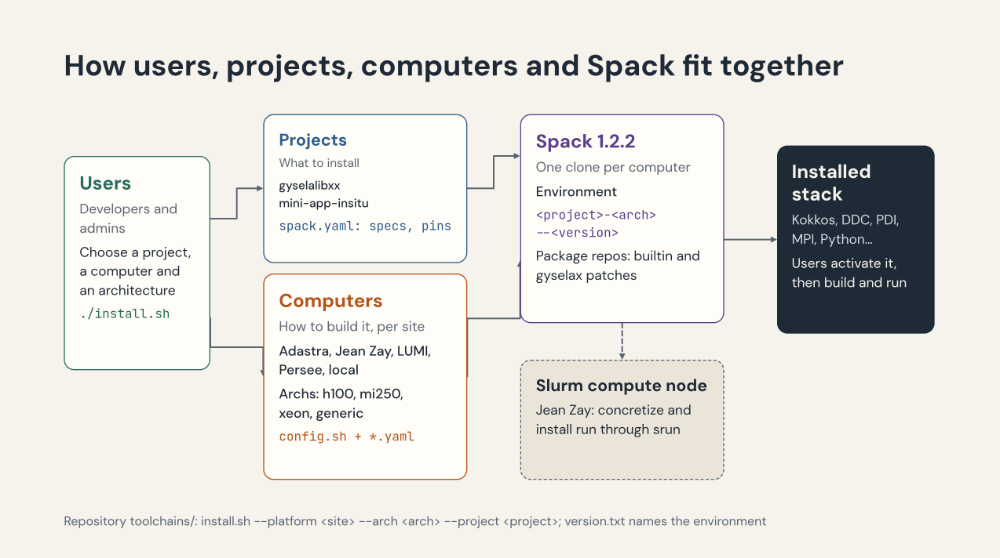

# env-installer

[](https://github.com/numpex/spack-stack/actions/workflows/ci.yaml)

Spack environments for the software stacks of [NumPEx](https://numpex.org)
applications together with
everything needed to install them on HPC platforms:

- **ready-to-use Spack environments** for each software stack (`projects/`);
- **a unified installer**, [`install.sh`](install.sh), which builds a stack on a supported
  HPC platform, combining the stack definition with site-specific configuration
  (externals, compilers, package repositories);
- **an OCI binary cache** on `ghcr.io/numpex/spack-stack`, continuously filled by CI, so
  that matching packages are downloaded instead of rebuilt from source.




## Install a stack on an HPC platform

`install.sh` combines the following inputs into a Spack environment named
`<project>-<arch>--<version>` (version from [`version.txt`](version.txt)):

| Input | Option | Files | Content |
|-------|--------|-------|---------|
| Stack | — | `common/*.yaml` | package repositories shared by all machines |
| Platform | `--platform` | `platforms/<site>/config.sh` | Spack location, parallel jobs, Slurm settings |
| Architecture | `--arch` | `platforms/<site>/<arch>/spack/*.yaml` | externals, package preferences, machine-specific repositories |
| Project | `--project` | `projects/<project>/spack.yaml` | the software stack to install |
| Project (optional) | — | `projects/<project>/spack/*.yaml` | project-specific repositories (e.g. `ai-inference` uses a `spack-packages` fork for `py-vllm`) |

Configuration is merged from the most specific layer to the most general one:
project, then machine, then stack. For instance, Adastra adds its
`patches_adastra` sub-repository to the package repositories defined in
`common/repos.yaml` (the `gyselax` fork of Spack, with the GYSELA recipes, and
the `builtin` repository pinned to the Spack release).

Example on CINES Adastra:

```console
$ ./install.sh --platform cines/adastra --arch mi300 --project <project>
```

By default it runs the following steps in order (run only one with `--step <step>`):

1. **spack** — clone Spack (release pinned in [`spack-version.txt`](spack-version.txt)) and bootstrap it *(needs internet)*
2. **env** — (re)create the environment, update the package repositories, optionally detect system packages *(needs internet)*
3. **concretize** — concretize and report the lockfile
4. **mirror** — download all sources to a local mirror *(Slurm mode only)*
5. **install** — build and install

On sites where compute nodes have no internet access (e.g. Jean-Zay), enable Slurm mode
with `--slurm-account <account>` (or the `SLURM_ACCOUNT` variable): sources are mirrored
from the login node, and `concretize`/`install` run on GPU compute nodes through `srun`.

Concurrent installations of the same environment are prevented by a lock file, and on
completion the installation tree is shared with the site group.

### Supported platforms

| Site | Machine | Architectures |
|------|---------|--------------|
| CINES | Adastra | `genoa` (CPU), `mi250`, `mi300` (AMD GPU) |
| IDRIS | Jean-Zay | `h100` (NVIDIA GPU, Slurm mode) |
| MDLS | Mandelbrot | `rtx6000` (NVIDIA GPU) |

The Adastra and Jean-Zay architectures also ship a `toolchain.cmake` with the recommended
compiler settings, reusable downstream with `cmake -C <toolchain.cmake>`.
